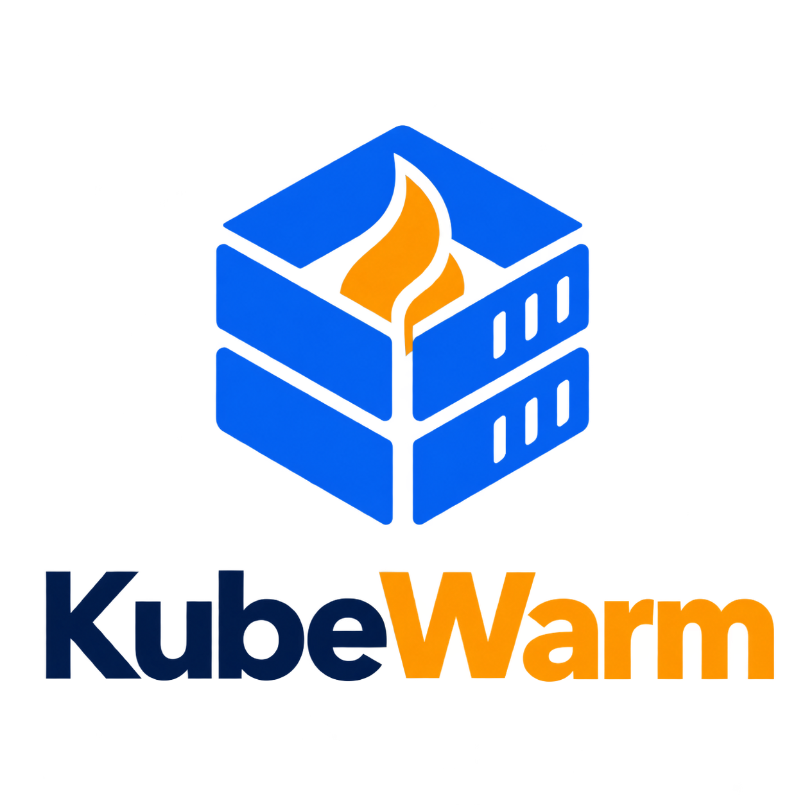
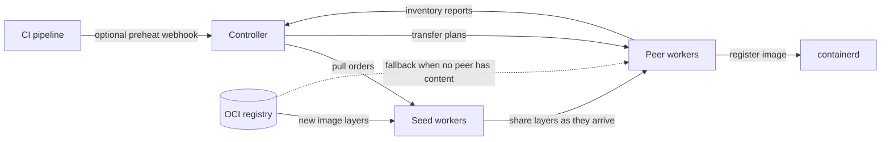

  

# KubeWarm

**A head start for Kubernetes image pulls.** KubeWarm starts preparing a pushed
image before a rollout needs it. The controller chooses seed nodes, and workers
share image content across the cluster instead of making every node fetch it
independently from the registry.

**Controller Deployment + worker DaemonSet. No CRDs, operator framework,
database, or external job queue.** This is source code to build and test; no
KubeWarm container images have been published.

## Contents

- [How it started](#how-it-started)
- [The idea](#the-idea)
- [Image flow](#image-flow)
- [Features](#features)
- [Documentation index](docs/README.md)
- [License](#license)

## How it started

Image pulls often begin only after a workload reaches a node. During a rollout,
many nodes can then request the same layers from the registry at once, adding
download time to startup and concentrating traffic on the registry. If the
registry cannot provide an image, a pod may remain stuck even when another
node already has its content. Meanwhile, cached images compete for node disk
space, including images that may be needed for rollback.

KubeWarm is designed to manage that image lifecycle: prepare images ahead of
use, share available content between nodes, recover eligible blocked pulls,
and clean unused images while retaining rollback candidates.

## The idea

Start as soon as CI knows the image digest. A best-effort webhook can order
preheating while the rest of the pipeline continues; the controller selects
seed nodes and workers spread missing content between peers, with the registry
as fallback. When a pipeline needs proof before deploying, the targeted warming
API waits for fresh worker inventories to confirm readiness on selected nodes.
Neither path replaces Kubernetes scheduling or guarantees application health.

## Image flow

The diagram shows global preheating and layer spreading. Targeted warming uses
the workers' whole-image peer transfer path and confirms readiness from fresh
worker inventory reports.

## Features

KubeWarm covers more than pre-pulling: it can recover blocked image pulls,
serve content through a containerd mirror, and clean unused images while
retaining rollback candidates. Use the webhook for best-effort preheating that
runs alongside a deployment, or the targeted warming API when CI should wait
for a specific image digest to be reported ready on selected nodes.

| Capability | Behavior |
| --- | --- |
| Image preheating | `/webhook/preheat` prepares images across the cluster before workloads need them. |
| Peer-to-peer distribution | Shares missing image layers between nodes. |
| Image pull recovery | Retrieves available image content from peer nodes for blocked image pulls. |
| Containerd mirror | Serves image content locally or from peers, with registry fallback. |
| Image cleanup | Reclaims disk space while prioritizing rollback-image retention. |
| Same-zone preference | Applies to layer spreading, whole-image propagation, rescue, mirror peer lists and targeted warming. Unknown metadata or unavailable/busy local sources fall back. |
| Targeted warming | `/v1/warmings` selects Ready, schedulable nodes by exact label equality and optionally by zone. It never calls the cluster-wide preheat path. |
| Continuous policies | JSON in a projected ConfigMap is reloaded every 10 seconds; matching newly discovered nodes are warmed after their workers report. |
| CI gate | Authenticated create/status API with total and per-zone thresholds, explicit timeout and a Python wait client. |

CI jobs use **immutable image digests**, not mutable tags. Readiness is established
from fresh worker inventories, not an accepted HTTP request. Image readiness is
not application health or a scheduling guarantee.

Targeted jobs use the worker's whole-image peer transfer protocol, with registry
pull fallback. The cluster-wide webhook distributes images blob by blob.
Containerd deduplicates image layers.

## Documentation

| Guide | Contents |
| --- | --- |
| [Installation and CI](docs/installation.md) | Build, kind runbook, CI warming requests and verification. |
| [Architecture](docs/architecture.md) | Components, state, image lifecycle and operational boundaries. |
| [Preheating](docs/preheat.md) | Webhook, seed selection, registry access and ranking metrics. |
| [Layer distribution](docs/propagation.md) | Blob spreading, fallbacks, limits and progress. |
| [Image pull recovery](docs/rescue.md) | Detection and recovery of blocked image pulls. |
| [Transfers](docs/transfers.md) | Peer transfer protocol, blob/snapshot decisions and integrity. |
| [Registry mirror](docs/mirror.md) | containerd mirror behavior, requirements and metrics. |
| [Image cleanup](docs/image-cleanup.md) | Cleanup rules, rollback retention and metrics. |
| [Node settings](docs/node-settings.md) | containerd and kubelet settings and limits. |
| [Configuration](docs/configuration.md) | Environment variables, defaults and Helm settings. |
| [HTTP API](docs/api.md) | Controller and worker endpoints. |
| [Observability](docs/observability.md) | Prometheus metrics, Grafana dashboard and origin checks. |
| [Operations](docs/operations.md) | Status, logs, troubleshooting, upgrades and uninstall. |
| [Configuration recipes](docs/recipes.md) | Suggested settings for common cluster needs. |
| [Security](docs/security.md) | Privileges, trust boundaries, credentials and hardening. |
| [Development and validation](docs/development.md) | Source layout, test coverage and validation results. |

## License

Licensed under [Apache-2.0](LICENSE).
